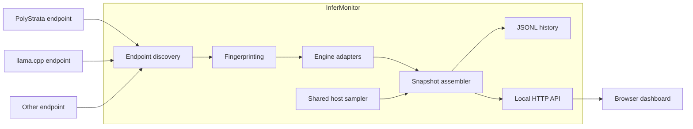

# System Architecture

## Style
One local companion process with background collector, engine adapters, shared host sampling, small HTTP API, static browser UI and append-only JSONL history. A modular monolith, not a distributed system.

## Context


## Collector cycle
1. Load and validate configuration.
2. Run one collector loop.
3. Probe enabled endpoints independently with bounded timeouts and response-size limits.
4. Fingerprint HTTP evidence; supplement with local process identity.
5. Select adapter or Unknown.
6. Compare identity with previous observation; create new session on confirmed replacement.
7. Collect engine metrics.
8. Sample host telemetry once for the cycle.
9. Assemble one cycle snapshot and append history.
10. Publish latest snapshot for API/UI.

## Components
| Component | Responsibility |
|---|---|
| Config | Defaults, validation, endpoint definitions |
| Discovery | Reachability, HTTP probe, optional process identity |
| Fingerprinter | Supported engine classification or Unknown |
| Adapter registry | Resolve detected/manual adapter |
| PolyStrata adapter | Parse Strata telemetry |
| llama.cpp adapter | Parse llama.cpp exposition |
| Host sampler | CPU/RAM/disk/GPU once per cycle |
| Session manager | Process lifetime and session boundaries |
| Snapshot assembler | Join endpoint results with host sample |
| History | JSONL append/read/retention |
| HTTP API | Snapshot, endpoints, health, history |
| UI | Endpoint cards, host panel, diagnostics |

## Deployment
```text
127.0.0.1:8090  InferMonitor UI/API
127.0.0.1:8080  PolyStrata OR llama.cpp
127.0.0.1:8081  Optional inference process
127.0.0.1:8082  Optional inference process
```
Inference runtimes remain separate; InferMonitor does not control them.

## Rules
- Host telemetry once per cycle.
- Engine telemetry per endpoint/unique process adapter context.
- Port is not process identity; PID alone is not process identity.
- Unknown engine is first-class.
- One adapter failure must not stop other targets.
- Missing values remain null.
- Browser lifecycle does not control collector lifecycle.
- UI reads snapshots; it does not poll inference servers directly.

## Timeouts and concurrency
Start with bounded timeouts and the simplest sequential or small bounded-worker strategy. Select based on measured cycle duration. Never create unbounded workers per poll.

## Extension points
Engine adapters, process discovery and hardware providers are isolated. Storage can be replaced without changing canonical telemetry DTOs. Remote monitoring is not MVP.