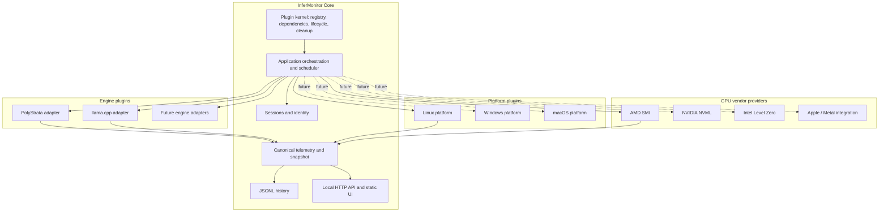

# System Architecture

**Status:** Proposed. Documentation baseline; implementation has not started.

## 1. Architecture style and decision

InferMonitor is a **single-process modular monolith** with a lightweight, Cordis-inspired in-process plugin composition kernel. It is not a distributed system and does not require a general-purpose plugin framework.

The kernel provides capability/service registration, dependency validation, lifecycle, health and cleanup. The application scheduler owns collection cadence. Plugins expose bounded operations; they do not own recurring polling loops, persistence, API or UI.

**Why this choice**
- A companion process must continue monitoring when browser tabs close.
- The initial workload is local, bounded to three endpoints and one host.
- A modular monolith avoids IPC, broker, container and distributed-consistency costs.
- Capability contracts prevent core code from depending on OS APIs, GPU vendors or engine implementations.
- Explicit lifecycle and cleanup are valuable for optional native vendor libraries.
- A small internal kernel preserves KISS better than a full Cordis runtime or arbitrary third-party plugin system.

See [PLUGIN_ARCHITECTURE.md](PLUGIN_ARCHITECTURE.md), [ADR-004](../decisions/ADR-004-cordis-inspired-plugin-kernel.md) and [ADR-005](../decisions/ADR-005-separate-platform-and-hardware-providers.md).

## 2. Requirement drivers

- Standalone companion; no inference-engine source modifications.
- Up to three independently monitored inference endpoints.
- Engine detection from actual HTTP evidence plus local process identity; never port alone.
- Same-port process replacement must create a new session.
- Shared host telemetry sampled once per cycle.
- Missing metrics remain null with explicit availability and provenance.
- Physical GPU memory remains distinct from engine-internal KV/expert/arena metrics.
- Linux + AMD is the first validation target; future OS and GPU vendors must not require a core rewrite.
- Local-only, read-only, privacy-preserving operation.
- Minimal dependencies and JSONL history initially.

## 3. Architecture



The diagram shows independent extension dimensions. It does not imply every vendor/OS combination is already supported.

## 4. Architectural boundaries

| Area | Owns | Must not own |
|---|---|---|
| Plugin kernel | Registration, dependencies, lifecycle, health, cleanup | Polling policy, telemetry persistence |
| Application scheduler | Cadence, timeout, bounded concurrency, cycle IDs | Vendor-specific parsing |
| Engine adapter | HTTP fingerprint and engine metrics | Host/GPU collection, sessions, storage |
| Platform provider | Process, CPU, RAM, disk and OS identity | GPU-vendor semantics |
| GPU provider | Device inventory and physical device metrics | Process listener discovery, engine KV/cache metrics |
| Session manager | Endpoint/process identity transitions | Provider-specific process APIs |
| Snapshot assembler | Correlation and shared sample references | Reinterpreting metric semantics |
| History | Versioned JSONL persistence and retention | Live provider polling |
| API/UI | Read published snapshots and history | Polling inference endpoints directly |

## 5. Collector cycle

1. Validate configuration and plugin registrations at startup.
2. Start required plugins in dependency order; optional provider failures are recorded without stopping the application.
3. Probe each enabled endpoint independently with bounded timeouts and response sizes.
4. Fingerprint actual HTTP evidence and corroborate with platform process identity when local.
5. Resolve supported adapter or Unknown; manual override remains explicit.
6. Compare endpoint/process identity and create a new session on confirmed replacement.
7. Collect engine telemetry per unique process/adapter context where safe.
8. Sample host CPU/RAM/disk once; enumerate/sample physical GPU devices once per cycle using selected providers.
9. Assemble endpoint observations referencing one host sample ID.
10. Append versioned JSONL records and publish the latest snapshot.
11. API/UI read the cached snapshot; browser lifecycle does not control collection.

## 6. Process, endpoint and device identity

- Endpoint identity is normalized scheme/host/port/base path.
- Local process identity uses host scope + PID + process start time; executable identity corroborates where available.
- Remote endpoints have endpoint-scoped sessions and no asserted local PID.
- GPU identity uses vendor UUID/native stable ID where available, otherwise PCI BDF or platform-native identity. Enumeration index is transient only.
- Weak identity is labelled; uncertain devices/processes are not silently merged.

## 7. Failure and scheduling

A plugin/provider failure is isolated. The scheduler applies bounded timeouts and small bounded concurrency. One endpoint, engine, GPU or optional library failure must not stop unrelated observations. Providers do not run independent loops.

## 8. Deployment

```text
127.0.0.1:8090  InferMonitor UI/API
127.0.0.1:8080  PolyStrata OR llama.cpp
127.0.0.1:8081  Optional inference process
127.0.0.1:8082  Optional inference process
```

## 9. Compatibility policy

Initial target: native Linux with AMD GPU telemetry. Future candidates: Linux/Windows with NVIDIA NVML; Linux/Windows with Intel Level Zero; Windows platform discovery; macOS platform and Apple GPU investigation. These are targets, not compatibility claims. Each combination must pass provider contract and integration tests with recorded OS, device, driver and library versions.

## 10. Deferred

Remote agents, multi-host aggregation, arbitrary third-party plugins, hot reload, distributed event buses, SQLite, Prometheus server, Grafana, message brokers and containers remain deferred until justified by requirements.
