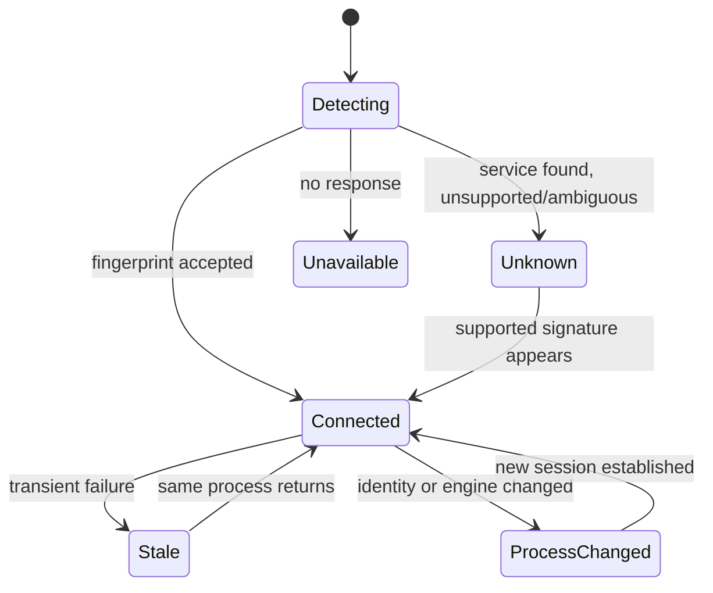

# Data Lifecycle and Session Model

## Collector cycle
One cycle has unique ID and UTC timestamp. It creates one host sample and up to three endpoint observations. Partial endpoint failure does not invalidate successful observations elsewhere.

## Process session lifecycle

Define a documented stale grace interval before marking a target gone. Timeout alone must not terminate a session.

## Persisted record classes
- session start/end events;
- cycle metadata;
- one host sample per cycle;
- endpoint observations referencing session and host sample IDs;
- structured diagnostic/error codes.

Avoid repeating host metrics inside endpoint records.

## Recovery
Read supported schema versions, tolerate/report malformed final partial line, recover prior sessions as inactive until identity is reconfirmed, and do not assume an inference server survived companion downtime.

## Retention
Seven days is the initial proposed default. Rotate by date or bounded size and prune only expired files.